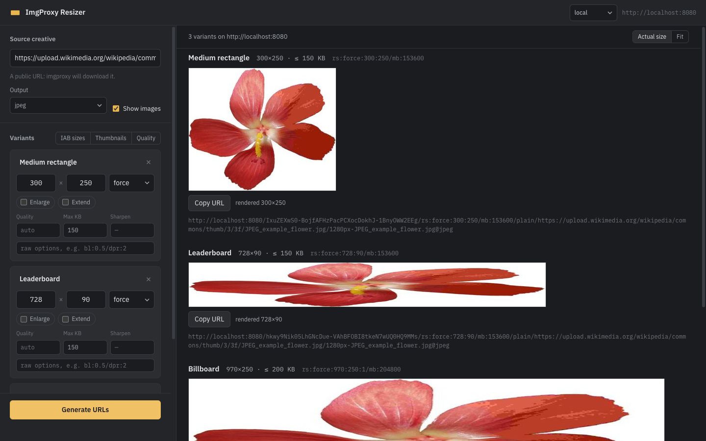

# ImgProxy Resizer

A local web UI that generates **signed [imgproxy](https://imgproxy.net) URLs**
from free-form processing options (`rs`, `q`, `mb`, `sh`, …) instead of the
presets configured on the server. Use it to try sizes, qualities and weight
limits on an image, look at the results at actual size, and copy the URLs.



## Setup

```bash
cp config.example.yml config.yml      # add your imgproxy hosts and hex key/salt
go run . -config config.yml
open http://127.0.0.1:8099
```

`config.yml` is gitignored. Each profile is one imgproxy deployment with its
host and the hex `IMGPROXY_KEY` / `IMGPROXY_SALT`; values go through `${ENV}`
expansion so secrets can stay in environment variables. A profile without a
key is disabled at startup with a warning. For a server that does not verify
signatures, set `insecure: true` instead.

Presets (one-click sets of variants) are defined in the same file, see
`config.example.yml` for the format.

To try it without a server, run imgproxy locally:

```bash
docker run --rm -p 8080:8080 -e IMGPROXY_KEY=736563726574 -e IMGPROXY_SALT=73616c7479 darthsim/imgproxy
```

and use a profile with `host: http://localhost:8080` and those two hex values.

## Usage

1. Pick the profile in the top bar, paste the **public** URL of the source
   image (imgproxy downloads it) and choose the output format (`jpeg` by
   default).
2. Prefill the variants with a preset, or edit the cards by hand: resize type,
   width, height, enlarge, extend, quality, max weight in KB, sharpen, raw
   options.
3. **Generate URLs**: one signed URL per variant, a copy button, the image
   rendered at actual size (toggle **Fit** to scale it down), and a text export.

Under each image the tool shows the rendered dimensions. If they differ from
the target, the most common cause is a target larger than the source: imgproxy
never upscales unless **Enlarge** is checked (the `:1` flag of `rs`).

How the card fields map to imgproxy options:

| Field | Option | Example |
|---|---|---|
| Resize type, width, height | `rs:<type>:<w>:<h>` | `rs:force:1093:411` |
| Enlarge | `:1` after the size | `rs:force:1640:616:1` |
| Extend | `:0:1` or `:1:1` after the size | `rs:fit:100:100:0:1` |
| Quality | `q:<1-100>` | `q:85` |
| Max KB | `mb:<bytes>` (KB × 1024) | `120` → `mb:122880` |
| Sharpen | `sh:<float>` | `sh:0.4` |
| Raw options | appended as is | `bl:0.5/dpr:2` |

## API

`POST /api/generate`

```json
{"profile":"production","source":"https://…/image.png","ext":"jpeg",
 "variants":[{"label":"small","resizeType":"fit","width":320,"height":180,"maxBytes":40960}]}
```

→ `{"profile":"production","host":"…","results":[{"label":"small","options":"rs:fit:320:180/mb:40960","path":"/…","url":"https://…"}]}`

Validation errors come back per variant in `error`; an unknown profile, a bad
source URL or format returns HTTP 400.

## Tests

```bash
go test ./...
```
